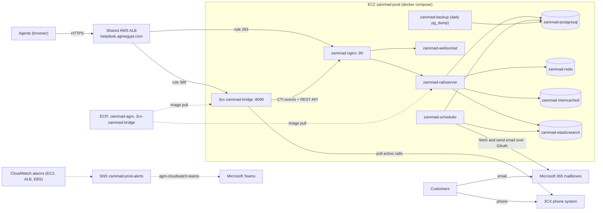

# Architecture

Production is one dedicated EC2 instance (`zammad-prod`, type `r6i.large`,
2 vCPU / 16 GB, region eu-central-1, private subnet, no public IP). It runs
Docker Compose. The instance and the compose file are defined in Terraform:
`AGM-One-Vision/agm-infrastructure` → `environments/prod/zammad.tf`.

## Components

| Container (compose service) | Image | Role |
|---|---|---|
| `zammad-nginx` | `zammad-agm:7.0.1-editor-extras-v3` (AGM build) | Web entry point. Publishes host port 80 (container port 8080) to the load balancer. |
| `zammad-railsserver` | same AGM image | Rails application: web UI, REST API, GraphQL. |
| `zammad-websocket` | same AGM image | Live updates to browsers. |
| `zammad-scheduler` | same AGM image | Background jobs: email fetching, triggers, schedulers, notifications, search indexing. |
| `zammad-init` | same AGM image | Runs once on first start or after a restore (database migrations and setup). |
| `zammad-backup` | same AGM image | Daily `pg_dump` at 03:00 Africa/Cairo, kept 10 days (`BACKUP_TIME`, `HOLD_DAYS`). |
| `zammad-postgresql` | `postgres:17.9-alpine` | Main database. |
| `zammad-redis` | `redis:8.6.2-alpine` | Key-value store used by the Rails services (`REDIS_URL`). |
| `zammad-memcached` | `memcached:1.6.41-alpine` | Cache (256 MB). |
| `zammad-elasticsearch` | `elasticsearch:8.18.0` | Full-text search index. |
| `3cx-zammad-bridge` | `3cx-zammad-bridge:<tag>` (AGM build, own repo) | Polls the 3CX phone system and creates phone tickets. Has an admin UI on port 8090 (see the bridge docs). |

The image tag says `7.0.1`, but the code inside is not the 7.0.1 release. The
image was built from branch `feature/editor-highlight-textalign` (tip
`fedf5211`), whose base is upstream `develop` of 2026-04-29 (`VERSION` file:
`7.1.x`). An admin check on 2026-08-23 recorded the running version as
`7.1.x-fedf5211.docker`. See [Reference → AGM changes](reference.md#agm-changes).

## How they talk

- Users open `https://helpdesk.agmegypt.com`. The shared AWS Application Load
  Balancer (ALB) ends TLS. Listener rule priority 393 (host
  `helpdesk.agmegypt.com`) forwards to `zammad-nginx` on port 80.
- A path-based ALB rule (389) forwards the bridge's admin UI to port 8090
  (see the bridge docs). The instance security group allows ports 80 and 8090
  from the ALB only.
- `zammad-nginx` proxies to `zammad-railsserver` and `zammad-websocket`.
- The Rails containers use PostgreSQL, Redis, Memcached and Elasticsearch by
  compose service name (`POSTGRESQL_HOST`, `REDIS_URL`, `MEMCACHE_SERVERS`,
  `ELASTICSEARCH_HOST`). They are not exposed outside the host; PostgreSQL is
  also published on the host's loopback interface only (`127.0.0.1:5432`).
- `3cx-zammad-bridge` polls the 3CX API for active calls. It sends call events
  to the Zammad CTI endpoint (`/api/v1/cti/<token>`) and uses the Zammad REST
  API (`/api/v1/users`, `/api/v1/tickets`, `/api/v1/ticket_articles`) with an
  API token.
- `zammad-scheduler` fetches and sends email through the email channels set up
  in the Zammad admin UI (Microsoft 365 mailboxes over OAuth).
- CloudWatch alarms publish to the SNS topic `zammad-prod-alerts`. The shared
  `agm-cloudwatch-teams` forwarder posts them to a Microsoft Teams channel
  (per the 2026-11-09 service catalog audit).
- Engineers reach the host only through AWS Systems Manager (SSM) Session
  Manager. There is no SSH port and no key pair.

## Diagram

## External dependencies

| Dependency | Used for | Notes |
|---|---|---|
| Amazon ECR repositories `zammad-agm` and `3cx-zammad-bridge` | Container images | The instance role has ECR read-only access. The `zammad-agm` image is pushed by hand. |
| Shared AWS ALB | TLS and routing for `helpdesk.agmegypt.com` | Host rule 393 for Zammad; path-based rule 389 for the bridge admin UI. DNS for the name is a CNAME to the ALB, managed in the AGM cPanel DNS zone. |
| AWS Systems Manager | Shell access and the nightly maintenance window | See [Deploy & operate](deploy-operate.md). |
| AWS Backup | Daily AMI backup of the instance, kept 30 days | Restore runbook: `agm-infra-notes/runbooks/zammad-restore.md`. |
| CloudWatch, SNS, Teams | Alarms | SNS `zammad-prod-alerts` → shared `agm-cloudwatch-teams` forwarder → Teams. The Terraform files also define their own alert Lambda; the audit marks it as unused drift (internal audit, Z10). |
| Microsoft 365 | Email channels (OAuth app registration in Entra ID) | Set up in the Zammad admin UI, not in this repo. |
| 3CX phone system | Source of phone calls | Through 3cx-zammad-bridge. The 3CX tenant owner is not confirmed. |
| Upstream Zammad | Source code, security fixes | <https://github.com/zammad/zammad>. See [Upgrading](deploy-operate.md#upgrading). |
| npm packages `@tiptap/extension-highlight` and `@tiptap/extension-text-align` (3.19.0) | AGM editor change | Added by AGM in `package.json`. |
